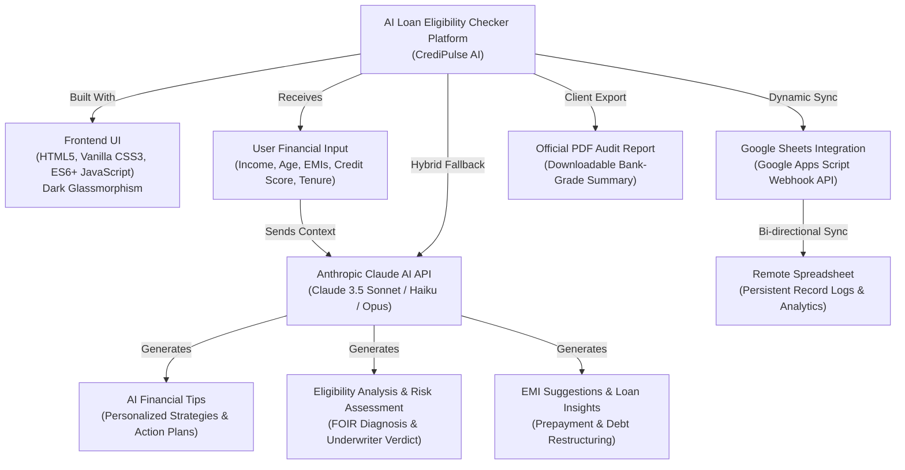

# 🏦 CrediPulse AI | AI-Powered BFSI Financial Intelligence Platform

**CrediPulse AI** is an AI-powered BFSI (Banking, Financial Services, and Insurance) web platform engineered to simplify and accelerate personal and retail financial decision-making. The platform unifies four core financial tools into an intuitive dark glassmorphism interface:

1. **Loan Eligibility Checker** (Institutional FOIR, DTI & annuity present-value modeling)
2. **Credit Score Analyzer** (5-pillar weighted FICO/CIBIL credit health engine with SVG speedometer)
3. **EMI Calculator & Amortization** (Real-time recalculations, Chart.js breakdown, and prepayment accelerator)
4. **AI Financial Tips & Claude Advisor** (Interactive AI financial advisor powered by Anthropic Claude 3.5 Sonnet + zero-latency built-in BFSI engine)
5. **Dynamic Google Sheets Persistence** (Dynamic session recording, Google Apps Script webhook integration, and CSV/JSON reporting)

---

## 🏛️ System Architecture

---

## 💻 Hardware & Software Requirements

### Hardware Requirements
| Component | Minimum Specification | Recommended Specification | Purpose |
| :--- | :--- | :--- | :--- |
| **Processor** | Intel Core i5 (10th Gen+) / AMD Ryzen 5 | Intel Core i7 / AMD Ryzen 7 or Apple M-Series | Multi-threaded client-side calculations & rendering |
| **RAM** | 8 GB DDR4 | 16 GB DDR4/DDR5 | Smooth AI reasoning execution, browser multitasking, and chart rendering |
| **Storage** | 256 GB SSD | 512 GB NVMe SSD | Fast project loading, local caching, and asset handling |
| **GPU (Optional)** | NVIDIA GTX 1650 or equivalent | NVIDIA RTX 3060+ or integrated Metal/Vulkan | Local ML model experimentation and accelerated canvas rendering |
| **Internet** | 10 Mbps stable connection | 50+ Mbps fiber connection | Low-latency Claude AI API queries & Google Sheets webhook transmission |

### Software Requirements
- **Operating System:** Windows 10/11 (64-bit), macOS (Monterey 12 or later), or Linux (Ubuntu 20.04+ LTS).
- **Web Browser:** Latest version of Google Chrome (v115+), Mozilla Firefox (v115+), Microsoft Edge (v115+), or Apple Safari (v16+).
- **Runtime (Optional for Local Server):** Python 3.8+ (`python -m http.server 8080`) or Node.js v18+ (`npx serve`).

---

## 🚀 Key Modules & Functional Specifications

### 1. Loan Eligibility Checker
- **FOIR / DTI Calculation:** Computes the applicant's Fixed Obligation to Income Ratio ($\text{FOIR} = \frac{\text{Existing EMIs} + \text{Proposed EMI}}{\text{Net Monthly Income}}$).
- **Annuity Present Value:** Calculates the maximum sanctionable loan amount using standard retail banking annuity formulas:
  $$PV = \frac{\text{EMI}_{\text{cap}} \cdot (1 - (1+r)^{-n})}{r}$$
- **Multi-Factor Risk Scoring:** Evaluates age at loan maturity ($\le 65$ years), employment type (Salaried, Self-Employed, Business, Freelance), and credit tier.
- **Co-Applicant Income Booster:** Supports adding co-borrowers (spouse/parents) to expand borrowing limits by up to 45%.

### 2. Credit Score Analyzer
- **5-Pillar Weighted Methodology:**
  1. *Payment History (35%):* On-time repayment track record.
  2. *Credit Utilization (30%):* Ratio of credit card balances to overall credit limit (ideal $\le 30\%$).
  3. *Credit History Age (15%):* Vintage of oldest active credit tradeline.
  4. *Credit Mix Diversity (10%):* Healthy proportion of secured (home/auto) vs. unsecured (cards/personal).
  5. *Recent Hard Inquiries (10%):* Rate shopping inquiries within past 12 months.
- **Interactive SVG Speedometer Gauge:** Visualizes score on a 300 to 900 scale with smooth needle and dynamic gradient colors.
- **Personalized Actionable Roadmap:** Outlines tactical steps with estimated point gains (e.g., *"+25 to +40 Points"*).

### 3. EMI Calculator & Amortization Schedule
- **Equated Monthly Installment Formula:**
  $$E = P \cdot r \cdot \frac{(1+r)^n}{(1+r)^n - 1}$$
- **Prepayment Accelerator:** Calculates early loan payoff and lifetime interest saved with supplemental monthly or lump-sum prepayments.
- **Interactive Visualizations:** Chart.js dark-themed Donut Chart for Principal vs. Interest split.
- **Yearly & Monthly Breakdown Table:** Complete amortization schedule with one-click CSV export.

### 4. Claude AI Financial Advisor & Tips
- **Anthropic Claude Integration:** Direct browser calls to Anthropic's Claude 3.5 Sonnet / Haiku / Opus models using client-side secure headers.
- **Zero-Latency Fallback Engine:** If no API key is supplied, a built-in BFSI intelligence engine provides deeply personalized underwriting commentary, strengths/vulnerabilities, and strategic action plans.
- **Interactive Advisory Chatbot:** Quick prompts for EMI reduction, 90-day credit score improvement, and tax benefits (Section 80C & 24b).

### 5. Google Sheets Data Integration
- **Google Apps Script Webhook:** Synchronizes every evaluation record to a remote Google Sheet.
- **Dynamic Session Storage:** Retains offline history in `localStorage` with manual batch sync capabilities.
- **Export Formats:** Direct export to `.csv` and `.json` files.

### 6. Official PDF Audit Report
- Bank-grade formatted assessment report ready for printing or instant PDF download with `html2pdf.js`.

---

## 📋 Google Sheets Integration Setup Guide

Follow these quick steps to connect your own Google Sheet in 2 minutes:

1. Open [Google Sheets](https://sheets.new) and create a new spreadsheet named `CrediPulse_BFSI_Records`.
2. In the top menu, navigate to **Extensions** > **Apps Script**.
3. Delete any default code in the script editor and copy-paste the contents of [`google-apps-script.js`](file:///c:/Users/ADMIN/Desktop/TEMP/nscom%20yuvraj/google-apps-script.js).
4. Click **Save** (disk icon), then click the blue **Deploy** button > **New deployment**.
5. Click the gear icon next to "Select type" and select **Web app**.
6. Set:
   - **Execute as:** `Me (your email)`
   - **Who has access:** `Anyone` (allows your frontend to submit data securely)
7. Click **Deploy**, approve permissions when prompted, and copy the generated **Web App URL** (e.g., `https://script.google.com/macros/s/AKfycb.../exec`).
8. In the CrediPulse AI platform, click **Settings** (gear icon in the top right), paste the Web App URL into the **Google Apps Script Web App URL** field, and click **Save Preferences**!

---

## 🌐 Deployment Instructions

### Deploy to Netlify
1. **Drag and Drop (Instant):**
   - Log in to [Netlify](https://app.netlify.com).
   - Drag and drop this project directory (`nscom yuvraj`) into the Netlify Sites dashboard.
   - Your site is live immediately with SSL!
2. **Git Repository Deployment:**
   - Push this repository to GitHub/GitLab.
   - Click "New site from Git" in Netlify.
   - Build command: *(leave empty)*.
   - Publish directory: `./` (or root).

### Deploy to Vercel
1. Install Vercel CLI: `npm i -g vercel`.
2. Run `vercel` in the project root directory.
3. Accept the default configuration (Framework Preset: *Other*, Root Directory: `./`).
4. Or connect via GitHub on [vercel.com](https://vercel.com) for automatic CD deployments on git push.

---

## 🛡️ Security & Privacy Practices
- **Client-Side Encryption/Storage:** All API keys and financial inputs are stored exclusively in the user's browser `localStorage`. No credentials are sent to external third parties other than direct calls to Anthropic's secure endpoints.
- **CORS Compliant:** Uses standard `no-cors` mode for Google Apps Script webhooks to prevent cross-origin preflight rejections.
- **Zero-Dependency Core:** Built using vanilla standards for maximum longevity, security, and instant loading speed.

---

## 🔮 Future Roadmap & Enhancements
- [ ] User authentication with Firebase / Supabase for multi-device profile persistence.
- [ ] Direct Bureau API integration (CIBIL / Experian / Equifax sandbox).
- [ ] Multi-currency support (USD $, EUR €, GBP £, AED) with real-time FX rates.
- [ ] Pre-trained client-side TensorFlow.js ML model for default probability prediction.
- [ ] Document OCR upload (Salary slip / Form 16 / Bank statement parsing).

---

*Designed and Developed for Modern Banking & Financial Services (BFSI) Decision Intelligence.*
